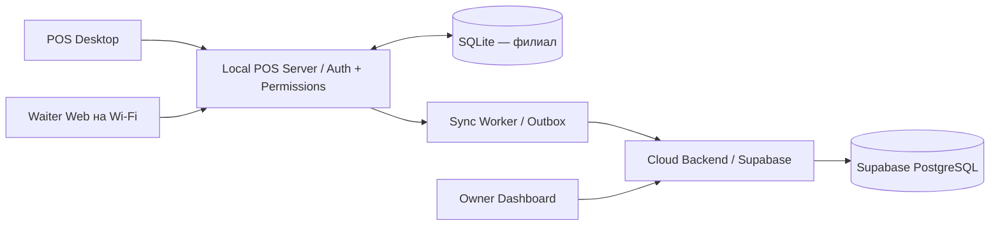

> **Уточнение 29.10.2026.** Поздние AUTH-002/AUTH-003 заменяют запрет PIN и локальный пароль новых Owner. POS idle 3 часа, Waiter Web idle 6 часов, absolute 12 часов; экран официанта блокируется после 120 секунд в фоне. Онлайн-Owner дополнительно зависит от Cloud token. [WAITER-UI-007](WAITER-UI-007%20Открытие%20стола%20и%20предпросмотр%20пакета.md).

# BASHKAR.KG
# AUTH-001 — Пользователи, роли, авторизация и разрешения

**Версия:** 1.0 — консолидация решений Q01–Q27  
**Дата:** 20 октября 2026 года  
**Статус:** функциональное ТЗ для MVP; согласованные решения консолидированы, низкоуровневая реализация уточняется в BACKEND-001 / DB-SCHEMA-001 / POS-001 / WAITER-001 / SYNC-001  
**Тип документа:** Software Requirements Specification / RBAC & Authentication Specification  
**Основания:** ARCH-001 v0.9; согласования AUTH-001 Q01–Q27; семь тематических разделов CORE-001.

> **Правило чтения.** Метка **[Согласовано]** обозначает решения Q01–Q27 либо прямое требование ARCH-001/CORE-001; **[Техническая конкретизация]** — предлагаемое техническое воплощение этих решений, которое допускается уточнить без изменения бизнес-правил. В конце документа отдельно перечислены места, где детализация или синхронизация редакций ещё потребуется. Настоящий AUTH-001 не заменяет финансовые, операционные и аварийные правила CORE-001.

---

# 1. Назначение и границы

## 1.1. Цель

Разработать для Bashkar.kg единую модель идентификации сотрудников, управления персоналом, ролями, разрешениями и локальными сессиями, которая:

1. обеспечивает работу ресторана после первоначальной активации **без доступа к интернету**;
2. проверяет каждую защищённую операцию на стороне **Local POS Server**;
3. связывает каждую операцию с **фактически авторизованным сотрудником**;
4. разделяет владельца организации, сотрудников филиалов и облачный кабинет;
5. не допускает эскалации прав, утечки паролей и доступа между организациями;
6. сохраняет связь архивных работников с историей заказов и финансовых операций;
7. поддерживает прозрачную облачную аналитику сотрудников без передачи локальных паролей.

## 1.2. Входит в AUTH-001

- учётная запись Owner и локальные учётные записи сотрудников;
- первичная активация и создание первого локального владельца;
- карточка сотрудника, статусы и архив;
- роли, разрешения, ограничения делегирования, контроль области доступа;
- вход, первоначальная установка и сброс пароля;
- сессии POS Desktop и Waiter Web, переключение пользователя;
- авторизация через QR-код адреса локального веб-клиента;
- режимы `STRICT` / `SHARED` с точки зрения доступа;
- идентификация исполнителей заказов, оплат, отмен и восстановления;
- аудит авторизации и административных действий;
- синхронизация безопасной информации о персонале с Supabase;
- ограничения безопасности, обработки ошибок и критерии приёмки.

## 1.3. Определяется другими ТЗ

| Документ | Зона ответственности |
|---|---|
| ARCH-001 | Local-First архитектура, размещение сервисов, HTTPS, серверная модель |
| CORE-001 — Столы, посещения и пакеты | Жизненный цикл TABLE, `STRICT`/`SHARED`, история исполнителей |
| CORE-001 — COUNTER | Кассовые заказы и их полномочия |
| CORE-001 — Кассовые смены | Открытие/закрытие, отдельная проверка пароля |
| CORE-001 — Оплаты и расчёты | Оплата, возвраты, скидки, финансовые исправления |
| CORE-001 — Отмены и корректировки | Правила отмены принятого заказа и запреты обходов |
| CORE-001 — Меню и ценообразование | Редактирование меню, цены, стоп-лист, сборы |
| CORE-001 — Нестандартные ситуации | Аварийное восстановление и расширенные полномочия |
| POS-001 / WAITER-001 | Экраны, навигация и UX |
| BACKEND-001 / DB-SCHEMA-001 | Физические API, SQL, индексы, миграции, транзакции |
| SYNC-001 | Протокол доставки, Inbox/Outbox, облачная модель и идемпотентность |

## 1.4. Приоритет правил

1. Явно согласованные AUTH-001 Q01–Q27 применяются к модели идентификации и разрешений.
2. Предметные правила CORE-001 регулируют допустимость ресторанной операции, даже если сотрудник имеет общее разрешение AUTH-001.
3. ARCH-001 регулирует границы систем и хранение данных, если не заменён более поздним согласованным решением AUTH-001.
4. Детали схем и транспортных контрактов определяются в реализации без расширения бизнес-прав.

---

# 2. Архитектура и контексты идентичности

## 2.1. Компоненты



**AUTH-BR-001.** [Согласовано] Local POS Server является единственным доверенным исполнителем локальной авторизации и проверок полномочий, а SQLite — основным хранилищем филиала. POS Desktop и Waiter Web — недоверенные клиенты по отношению к идентичности и полномочиям.

**AUTH-BR-002.** [Согласовано] Обычная работа заранее созданного сотрудника (вход, заказы, столы, оплаты, смены при соответствующих правах) не зависит от доступности интернета или Supabase.

**AUTH-BR-003.** [Согласовано] Существует два **разных** контекста авторизации:

- **Cloud Owner Identity:** единая учётная запись владельца организации в Supabase Auth, используемая для первичной активации и облачного Owner Dashboard;
- **Branch Local Identity:** самостоятельная локальная учётная запись Owner и учётные записи Manager/Cashier/Waiter в SQLite конкретного филиала.

Для новых активаций AUTH-003 используется онлайн-вход Owner по облачным email/паролю, без отдельного локального пароля владельца. Локальный actor OWNER сохраняется для прав и истории. Прежние локальные Owner продолжают работать в переходном режиме; их credentials не удаляются автоматически.

**AUTH-BR-004.** [Согласовано] Один владелец организации может видеть свои филиалы в Owner Dashboard. Обычные сотрудники филиалов **не имеют общей межфилиальной учётной записи**: при работе в другом филиале создаётся самостоятельная локальная запись.

**AUTH-BR-005.** [Согласовано] Данные и полномочия всегда ограничены `organization_id` и `branch_id`; сервер филиала не принимает запросы, позволяющие управлять чужим филиалом или организацией.

## 2.2. Разделение владения данными

| Вид данных | Авторитетный источник | Получатель / потребитель |
|---|---|---|
| Локальные сотрудники, их статус и разрешения | SQLite филиала | POS, Waiter; безопасная облачная копия |
| Пароли сотрудников, локальные сессии | Local POS Server + SQLite / защищённое хранилище секретов | Только локальная проверка; **не Supabase** |
| Облачный Owner и облачный вход | Supabase Auth | Owner Dashboard, активация |
| Текущие ресторанные операции | Local POS Server + SQLite | POS, Waiter, Outbox |
| Статистика персонала | Supabase по синхронизированным операциям | Owner Dashboard, режим просмотра |
| Локальный Audit Log | SQLite | Локальный административный просмотр; выборочная синхронизация |

## 2.3. Идентификация сотрудника

**AUTH-BR-006.** `employee_id` — постоянный технический идентификатор одной локальной учётной записи, а не отображаемое имя, логин, телефон или должность.

**AUTH-BR-007.** Сервер выводит идентичность исполнителя **из проверенной сессии**. Клиентский `employee_id`, `role`, `permissions` или заголовок с этими данными не является доказательством личности. При их несовпадении с сессией клиентские значения игнорируются либо команда отклоняется.

**AUTH-BR-008.** В истории заказа различаются:

- `opened_by_employee_id` — кто открыл посещение;
- `responsible_waiter_id` — ответственный официант;
- `submitted_by_employee_id` — кто отправил конкретный пакет;
- исполнитель оплаты, отмены, скидки, корректировки, возврата и административного изменения.

Ни один из этих атрибутов не подменяет остальные.

---

# 3. Организация, филиалы и первый запуск

## 3.1. Модель Owner

**AUTH-BR-009.** [Согласовано] В рамках выбранной модели организация имеет **одну основную учётную запись Owner** для облачного кабинета. Она управляет набором принадлежащих организации филиалов в пределах доступных функций Owner Dashboard.

**AUTH-BR-010.** [AUTH-003] В филиале сохраняется локальный actor OWNER, связанный с облачным владельцем. Новая активация не создаёт пользовательский локальный пароль Owner; прежние локальные Owner сохраняют переходный вход.

**AUTH-BR-011.** Управление сотрудниками выполняется через POS Desktop филиала с серверной проверкой полномочий. Новый Owner проходит онлайн-авторизацию AUTH-003; прежний локальный Owner сохраняет переходный вход. Удалённое редактирование персонала отдельным Owner Dashboard не реализовано.

## 3.2. Первичная активация: UC-AUTH-001

**Предусловия:** установленный локальный сервер, впервые подключённый филиал, доступ к интернету для начальной активации.

1. Установщик развёртывает POS Desktop, Local POS Server, SQLite и остальные предусмотренные ARCH-001 компоненты.
2. Владелец выполняет **облачный вход через Supabase Auth**.
3. Система получает доступные этому владельцу организацию и филиал; владелец выбирает нужный филиал.
4. Выполняется регистрация/привязка Local POS Server к выбранному филиалу и получение разрешённой начальной конфигурации.
5. Владелец задаёт **отдельный локальный пароль Owner** для данного филиала.
6. Local POS Server завершает локальную инициализацию, создаёт локальную запись Owner и необходимую привязку к облачной идентичности.
7. Владелец может создавать сотрудников филиала через POS Desktop.
8. После успешной активации обычные локальные авторизация и ресторанные операции работают без интернета.

**AUTH-BR-012.** [Согласовано] Первый запуск/регистрация нового филиала требует проверки облачного Owner; это **не** означает требования постоянной облачной связи для действующего филиала.

**AUTH-BR-013.** [Согласовано] Инсталляция не должна поставляться с универсальным рабочим паролем вроде `admin/admin`.

**AUTH-BR-014.** [Техническая конкретизация] Повторная активация после восстановления из резервной копии требует проверенной процедуры привязки к филиалу и защиты от выдачи чужому компьютеру полномочий на операции другого филиала. Детальный протокол — SYNC-001 / BACKEND-001.

---

# 4. Сотрудники и карточка персонала

## 4.1. Минимальная карточка — Q14=A

| Поле | Обязательность | Смысл |
|---|---|---|
| `employee_id` | Автоматически | Неизменяемый идентификатор записи |
| `branch_id` | Автоматически | Филиал, на котором создан сотрудник |
| `first_name` / отображаемое имя | Да | Имя сотрудника |
| `login` | Да | Локальный логин; уникален в филиале |
| `role` | Да | `MANAGER`, `CASHIER`, `WAITER` (Owner создаётся через активацию) |
| Первоначальный пароль | Да, генерирует система | Не редактируется администратором как постоянный секрет |
| `last_name` | Нет | Фамилия |
| `phone` | Нет | Контактный телефон |
| `status` | Автоматически | Новая запись — `ACTIVE` |
| `created_at`, `created_by` | Автоматически | Время и фактический инициатор |

**AUTH-BR-015.** [Согласовано] Для MVP не требуются должность сверх роли, фото, кадровые документы, дата приёма и другие персональные сведения.

**AUTH-BR-016.** [Согласовано] Менеджер может создать сотрудника только при индивидуальном разрешении и в своём филиале. Менеджер не создаёт Owner и не изменяет филиал локальной записи.

**AUTH-BR-017.** [Согласовано] Логин уникален в границах филиала; различие логинов между филиалами допускается. Нормализация регистра и схема индекса — DB-SCHEMA-001.

**AUTH-BR-018.** [Согласовано] Создание сотрудника не открывает ему доступ до завершения установки личного пароля при первом входе (см. §7).

## 4.2. Управление сотрудниками

Поддерживаются операции:

- создать сотрудника (Owner или отдельно уполномоченный Manager);
- посмотреть список и карточку сотрудника в разрешённом филиале;
- изменить имя, фамилию, телефон, роль и отдельные разрешения в установленных пределах;
- перевести в `SUSPENDED` и восстановить из `SUSPENDED`;
- перевести в `DEACTIVATED` и переместить в архив;
- запустить сброс пароля, не раскрывая старый пароль;
- просматривать архив по соответствующим административным правам.

**AUTH-BR-019.** Изменения ролей, статуса, разрешений и пароля не изменяют `employee_id` и не переписывают историю совершённых операций.

**AUTH-BR-020.** Менеджер не может изменить собственную роль, собственные разрешения, собственный статус для обхода ограничений, местную запись Owner и полномочия управления другими филиалами.

---

# 5. Статусы и жизненный цикл учётной записи

## 5.1. Состояния — Q07=B

| Статус | Доступ к входу и новым операциям | Назначение |
|---|---|---|
| `ACTIVE` | Допустим после настройки постоянного пароля и проверок | Работающий сотрудник |
| `SUSPENDED` | Запрещён | Временная блокировка с возможностью восстановления |
| `DEACTIVATED` | Запрещён | Уволенный / окончательно архивированный сотрудник |

**AUTH-BR-021.** Переход `ACTIVE → SUSPENDED` либо `ACTIVE/SUSPENDED → DEACTIVATED` немедленно отзывает действующие локальные сессии сотрудника и запрещает новые операции.

**AUTH-BR-022.** `SUSPENDED → ACTIVE` допускается уполномоченным администратором с обязательной записью в аудит. Восстановление статуса **не** означает автоматического возвращения отдельно отозванных разрешений.

## 5.2. Деактивация и архив — Q26=A

**AUTH-BR-023.** Обычное физическое удаление учётной записи через POS запрещено, включая случаи, когда за сотрудником уже закреплена история.

**AUTH-BR-024.** `DEACTIVATED` скрывает запись из списка активных сотрудников, но сохраняет `employee_id`, историю входов, заказов, оплат, корректировок и административных действий. Архив доступен уполномоченным сотрудникам.

**AUTH-BR-025.** Архивная запись не может снова авторизоваться; принятые ею операции не удаляются и не переходят к другим сотрудникам.

## 5.3. Повторный приём — Q27=B

**AUTH-BR-026.** [Согласовано] Если ранее уволенный сотрудник снова принят в филиал, администратор создаёт **новую запись и новый `employee_id`**, а старая остаётся `DEACTIVATED`.

**AUTH-BR-027.** [Согласовано] Статистика и история старого периода не объединяются автоматически с новым периодом, даже если совпадают имя и телефон.

**AUTH-BR-028.** [Техническая конкретизация] Для MVP предлагается **не выдавать ранее использованный логин повторно**, чтобы исключить путаницу с архивом и старыми ссылками. Новый сотрудник получает новый логин. Это защитное решение реализации; возможность последующего повторного использования логина не согласована отдельно.

## 5.4. Действующие заказы при блокировке — Q25=A

**AUTH-BR-029.** Блокировка или деактивация не завершает посещения, не отменяет пакеты, не освобождает столы и не закрывает кассовую смену.

**AUTH-BR-030.** При `STRICT` обслуживание незавершённых столов заблокированного официанта может продолжить менеджер либо кассир с **отдельно необходимыми правами** доступа к чужому посещению и выполнения конкретной операции.

**AUTH-BR-031.** Исходный `opened_by_employee_id` и отправители существующих пакетов сохраняются. Новые действия записываются за реальными исполнителями. В `SHARED` ответственный официант может передать свой стол другому активному официанту; изменение `responsible_waiter_id` записывается отдельным событием и не переписывает историю.

---

# 6. Роли, разрешения и модель проверки доступа

## 6.1. Роли — Q01=C, Q04=B

| Роль | Типичная ответственность |
|---|---|
| `OWNER` | Локальное администрирование своего филиала; единая облачная личность владельца организации |
| `MANAGER` | Управление работой ресторана и разрешённое администрирование персонала |
| `CASHIER` | Кассовая смена, COUNTER, расчёты, операции POS |
| `WAITER` | Посещения столов, пакеты заказов, доступные операции Waiter Web |

**AUTH-BR-032.** [Согласовано] Модель — **ролевые шаблоны + индивидуальные разрешения**. Роль задаёт базовые права и верхние границы полномочий; отдельные разрешения могут предоставляться или отзыватьcя уполномоченным администратором в допустимом диапазоне.

**Техническое уточнение ROLE-MATRIX-001 (29.10.2026).** Owner может сохранить явное общее правило права для ролей Manager, Cashier и Waiter в текущем филиале. Это правило применяется ко всем сотрудникам роли и имеет приоритет над ранее созданными индивидуальными исключениями. Там, где общего правила нет, действуют индивидуальные исключения и исходный ролевой шаблон. Системный предел роли и предметные проверки операций сохраняются. Изменение индивидуального исключения поверх явного правила роли сервер отклоняет.

**AUTH-BR-033.** Любая операция допускается только при одновременном выполнении условий:

```
подтверждённая действующая сессия
AND статус сотрудника = ACTIVE
AND филиал/организация соответствуют объекту
AND роль не запрещает действие
AND у сотрудника есть требуемое разрешение
AND соблюдено ограничение доступа к конкретному объекту
AND соблюдены предметные правила CORE-001
```

Клиентская видимость кнопки не является достаточным основанием для выполнения операции.

## 6.2. Легенда матрицы

- **✓** — право входит в исходный ролевой шаблон; администратор может отозвать его в допустимом диапазоне, если это не разрушает обязательные системные инварианты;
- **○** — право **не выдано по умолчанию** и доступно только после явного разрешения;
- **—** — запрещено для роли в MVP; дополнительный grant не может снять запрет.

Матрица фиксирует согласованный Q05 и ограничения соответствующих CORE-001. Применение конкретной операции также зависит от области доступа и состояния смены/заказа.

## 6.3. Базовая матрица операций ресторана — Q05=A

| Действие | Owner | Manager | Cashier | Waiter |
|---|:---:|:---:|:---:|:---:|
| Видеть доступные состояния столов, открывать стол, отправлять TABLE-пакет | ✓ | ✓ | ✓ | ✓ |
| Регистрировать полный расчёт TABLE при доступе к посещению | ✓ | ✓ | ✓ | ○ |
| Назначать/изменять фиксированную скидку на доступный заказ | ✓ | ✓ | ✓ | ✓ |
| Исправлять/отменять часть **принятого** заказа | ○ | ○ | ○ | ○ |
| Полностью отменять **принятый** заказ | ○ | ○ | ○ | — |
| Создавать и подтверждать COUNTER | ○ | ○ | ✓ | — |
| Регистрировать расчёт COUNTER | ○ | ○ | ✓ | — |
| Оформлять допустимый возврат | ○ | ○ | ✓ | — |
| Открывать/закрывать кассовую смену | ○ | ○ | ✓ | — |

**Уточнения по матрице:**

1. Строка просмотра/открытия TABLE **не** позволяет официанту читать чужие подробности при `STRICT`. Проверки `STRICT`/`SHARED` и отдельного разрешения обязательны.
2. Для исправления **черновика** действуют более простые правила владельца черновика, не требующие разрешения корректировки принятого заказа.
3. Полная отмена запрещена обычной роли Waiter, включая обход через последовательное удаление последней действующей позиции.
4. `COUNTER` не наследует автоматически режим `STRICT/SHARED`; он управляется собственными правами и областью кассового заказа.
5. Право расчёта TABLE не предоставляет право просматривать все чужие столы.
6. Скидка — фиксированная сумма на заказ; она применяется по финансовым правилам CORE-001, до расчёта и без отрицательной итоговой стоимости.
7. «Возврат» и «исправление ошибочной регистрации оплаты» — разные виды операций и могут требовать разных разрешений.

## 6.4. Администрирование и специальные операции — Q05=A

| Действие | Owner | Manager | Cashier | Waiter |
|---|:---:|:---:|:---:|:---:|
| Создавать / редактировать сотрудников филиала | ✓ | ○ | — | — |
| Назначать и отзывать разрешения | ✓ | ○ | — | — |
| Приостанавливать / деактивировать сотрудника | ✓ | ○ | — | — |
| Редактировать меню и цены | ✓ | ○ | — | — |
| Управлять стоп-листом | ✓ | ○ | ○ | — |
| Изменять `STRICT` / `SHARED` | ✓ | ○ | — | — |
| Настраивать сервисные / дополнительные сборы | ✓ | ○ | — | — |
| Перенаправлять печать на доступный принтер | ○ | ○ | ○ | — |
| Подтверждать аварийную сверку / ручную восстановительную регистрацию | ○ | ○ | ○ | — |

**AUTH-BR-034.** [Согласовано] Перенаправление печати и аварийная сверка не должны автоматически предоставляться всем администраторам только из-за названия роли.

**AUTH-BR-035.** [Согласовано + CORE-001] Для действий повышенного риска применяются дополнительные предметные проверки: причина корректировки/отмены, состояние расчёта, наличие подтверждающих документов, проверка исходных операций и отдельный аудит. Восстановление повреждённой базы и изменение исторической отчётности не становятся штатными правами кассира через общий grant «аварийная сверка».

## 6.5. Предлагаемый каталог permission-key

**[Техническая конкретизация]** Имена ключей ниже — логический контракт AUTH-001; окончательные строковые названия и маршруты утверждаются в BACKEND-001. Семантика операций обязательна, независимо от названия ключа.

| Домен | Предлагаемые разрешения |
|---|---|
| TABLE | `table.view_status`, `table.view_details`, `table.open`, `table.batch.submit`, `table.access_others`, `table.settle` |
| ORDERS | `order.discount.set`, `order.correction.apply`, `order.cancel_full` |
| COUNTER | `counter.create`, `counter.view`, `counter.settle`, `counter.cancel_full` |
| FINANCE | `payment.refund`, `payment.reversal`, `payment.history.view` |
| SHIFTS | `shift.open`, `shift.close`, `shift.report.view` |
| EMPLOYEES | `employee.create`, `employee.edit`, `employee.status.manage`, `employee.password.reset`, `employee.permissions.manage`, `employee.archive.view` |
| MENU | `menu.edit`, `menu.stoplist.manage`, `menu.conflict.resolve` |
| CONFIG | `settings.table_access_mode.manage`, `settings.service_charge.manage` |
| PRINT | `print.redirect` |
| RECOVERY | `recovery.incident.view`, `recovery.reconcile`, `recovery.database_restore.approve` |
| AUDIT | `audit.security.view` |

Если конкретный permission-key объединяет несколько рисковых действий, сервер должен дополнительно проверять их предметные условия; особенно это относится к финансовым исправлениям и восстановлению БД.

## 6.6. Делегирование Manager — Q03=B, Q06=B

**AUTH-BR-036.** Owner определяет **какие конкретно разрешения Manager вправе делегировать** сотрудникам своего филиала.

**AUTH-BR-037.** Manager может предоставить разрешение другому сотруднику только при выполнении всех условий:

1. разрешено управление правами (`employee.permissions.manage`);
2. целевая запись принадлежит тому же филиалу;
3. само разрешение входит в разрешённый Owner набор делегирования;
4. Manager не превышает собственные действующие полномочия;
5. целевая роль допускает это разрешение;
6. Manager не изменяет собственные права, не назначает Owner и не снимает системные запреты.

**AUTH-BR-038.** Отзыв Manager права делегирования действует для новых команд немедленно. Делегирование, совершённое до отзыва, сохраняется в истории с автором и временем; актуальные grants приводятся в соответствие политике уполномоченным Owner по административным правилам.

**AUTH-BR-039.** Даже Owner не может «разрешением» обходить системные инварианты: чужую организацию, отсутствие активной смены для требующей её операции, повторную оплату, несовместимое состояние заказа или попытку бесследной перезаписи истории.

## 6.7. Изменение прав в работающей системе

**AUTH-BR-040.** Изменение статуса, роли или разрешения применяется сервером к **каждой новой команде**. Уже открытый интерфейс не сохраняет старые полномочия до повторного входа.

**AUTH-BR-041.** После обновления разрешений сервер уведомляет доступные клиенты о необходимости обновить состояние/права; серверная проверка обязательна независимо от доставки уведомления.

**AUTH-BR-042.** Административная операция должна быть атомарной и аудируемой, включая: исполнитель, целевой сотрудник, прежнее/новое значение, результат, время сервера, филиал.

---

# 7. Пароли и первый вход

## 7.1. Единственный метод локального входа — Q02/Q09 (итоговая упрощённая редакция)

**AUTH-BR-043.** [Актуализировано 24.10.2026, AUTH-002] CASHIER входит по PIN либо локальному логину/паролю; MANAGER — по локальному логину/паролю; WAITER — по PIN в HTTPS Waiter Web. PIN не обходит права, отзыв сессии или отдельное подтверждение рискованных операций.

**AUTH-BR-044.** [Согласовано] Нет обязательной регистрации «доверенных» смартфонов/компьютеров, привязки PIN к устройству или подтверждения новых устройств менеджером.

**AUTH-BR-045.** Облачный пароль Owner не проверяется локальным POS как пароль сотрудника. Локальные пароли сотрудников не используются для входа в Supabase Auth.

## 7.2. Первоначальный пароль — Q15=B

**UC-AUTH-002 — Создание и первый вход сотрудника**

1. Owner или уполномоченный Manager создаёт карточку сотрудника.
2. Local POS Server генерирует **случайный временный пароль**.
3. Сервер сохраняет только его защищённый проверочный хеш и признак `must_change_password=true`.
4. В интерфейсе создания временный пароль показывается **один раз** для передачи новому сотруднику.
5. Сотрудник открывает POS Desktop либо Waiter Web и вводит логин и временный пароль.
6. Сервер подтверждает временный пароль, но даёт доступ **только к установке личного пароля**, не к заказам и оплатам.
7. Сотрудник устанавливает собственный допустимый пароль.
8. После успешной фиксации изменения временный пароль становится недействительным; `must_change_password=false`.
9. Только после этого формируется обычная рабочая сессия.

**AUTH-BR-046.** Нельзя повторно открыть или «посмотреть» исходный временный пароль. Если пароль утрачен, нужен новый административный сброс.

**AUTH-BR-047.** [Техническая конкретизация] Пароль должен генерироваться криптографически стойким источником случайных данных, без шаблонов вида «имя123» и общего стандартного пароля.

## 7.3. Простая политика паролей — Q16=A

**AUTH-BR-048.** [Согласовано] Минимальная длина личного пароля — **8 символов**.

**AUTH-BR-049.** [Согласовано] Обязательные числа, прописные буквы и специальные символы **не требуются**. Не допускаются явно распространённые/легко угадываемые пароли.

**AUTH-BR-050.** [Согласовано] Повторные неверные попытки входа ограничиваются локальным сервером. Реализация должна предотвращать автоматический перебор и не допускать массовой блокировки всего персонала одним злоумышленником.

**AUTH-BR-051.** [Согласовано] Пароли не хранятся в открытом виде, не печатаются в логах, не передаются в Owner Dashboard и не синхронизируются в Supabase, включая хеши.

**AUTH-BR-052.** [Техническая конкретизация] Применять стойкий алгоритм хеширования паролей с индивидуальной солью, например **Argon2id**, с протестированными на минимальной POS-конфигурации параметрами. Обычное `SHA-256(password)` и обратимое шифрование вместо хеширования недопустимы.

**AUTH-BR-053.** [Техническая конкретизация] Параметры ограничителя подбора (количество попыток, задержки, окна, журнальные квоты) — в конфигурации реализации и тестах безопасности; отдельно согласованных числовых порогов нет. Наиболее безопасный базовый принцип — постепенная задержка по идентичности и источнику запроса без глобальной блокировки сервиса.

**AUTH-BR-054.** [Техническая конкретизация] Принудительная плановая смена действующего пароля без причины не предусмотрена. Смена обязательна для временного пароля или после административного сброса и может потребоваться при подтверждённом компрометировании.

## 7.4. Смена и сброс пароля — Q08=B

**UC-AUTH-003 — Сотрудник помнит старый пароль:** вводит старый и новый пароль; Local POS Server валидирует их, обновляет защищённый хеш, отзывает прежние рабочие сессии и предлагает повторный вход с новым паролем.

**UC-AUTH-004 — Пароль забыт:** Owner либо Manager с отдельным правом инициирует **локальный сброс**; Local POS Server генерирует новый временный пароль, показывает один раз, устанавливает обязательную смену при первом входе, отзывает текущие сессии. Менеджер не может сбросить пароль Owner.

**AUTH-BR-055.** Сброс пароля не снимает `SUSPENDED` или `DEACTIVATED` и не выдаёт новых разрешений.

**AUTH-BR-056.** Администратор никогда не получает доступ к прежнему личному паролю сотрудника.

---

# 8. Сессии, выход и работа на нескольких клиентах

## 8.1. Модель сессии

**AUTH-BR-057.** Local POS Server выдаёт локальную сессию только после успешного завершения необходимого этапа входа. Токен/идентификатор сессии подтверждает контекст филиала и сотрудника, но клиент не вправе самостоятельно менять права в нём.

**AUTH-BR-058.** Обязательны: серверная проверка активности сессии, актуального статуса сотрудника и актуальных разрешений на каждой защищённой операции; выход и отзыв доступны без доступа к интернету.

## 8.2. Сроки — Q10 (фиксированные правила), Q17=B

| Клиент | Истечение при бездействии | Максимальное время одной сессии |
|---|---:|---:|
| POS Desktop | **3 часа** | **12 часов** |
| Waiter Web | **6 часов** | **12 часов** |

**AUTH-BR-059.** По достижении любого предела доступ прекращается и требуется новый вход с логином и паролем.

**AUTH-BR-060.** Действия сотрудника могут сдвигать окно бездействия, но не продлевают абсолютные 12 часов. Фиксированные сроки в MVP **не настраиваются** владельцем по филиалам.

**AUTH-BR-061.** [Техническая конкретизация] Пассивные фоновые опросы/автоматическое обновление интерфейса не должны бесконечно продлевать сессию. Сервер определяет активность по принятому типу пользовательского взаимодействия и собственной серверной метке времени.

**AUTH-BR-062.** Выход, истечение сессии и переключение пользователя **не закрывают** кассовую смену, не удаляют уже принятые заказы и не освобождают столы.

## 8.3. Переключение на общем POS — Q18=B

**UC-AUTH-005 — «Сменить пользователя»**

1. Авторизованный пользователь нажимает кнопку **«Сменить пользователя»**.
2. POS Desktop инициирует отзыв текущей локальной сессии на этом компьютере.
3. Интерфейс переходит на экран входа.
4. Другой сотрудник вводит свой логин и пароль.
5. Сервер создаёт новую сессию; POS отображает доступные новому сотруднику функции.
6. Уже открытая Cash Shift продолжает действовать. Следующие операции принадлежат новому сотруднику.

**AUTH-BR-063.** Список доверенных устройств сотрудников не требуется. Вход по PIN реализован для CASHIER/WAITER по AUTH-002; это не регистрация доверенного телефона.

## 8.4. Параллельные сессии

**[Техническая конкретизация вместо неутверждённого Q28.]** Сотрудник может иметь отдельные обычные сессии на разных клиентах без реестра доверенных устройств. Каждая сессия имеет собственное истечение и может быть отозвана; блокировка сотрудника, деактивация, смена/сброс пароля отзывают все его локальные сессии. Не создаётся специальная привязка статуса TABLE к телефону и не даются дополнительные права из-за количества сессий.

**AUTH-BR-064.** Все конкурентные операции через такие сессии по-прежнему подчиняются блокировкам, версиям, идемпотентности и ограничениям CORE-001.

---

# 9. Waiter Web и локальная сеть

## 9.1. Подключение — Q19=A

**UC-AUTH-006 — Первый вход официанта с телефона**

1. Смартфон подключён к **служебному Wi-Fi** ресторана.
2. POS Desktop отображает QR-код для подключения официантов.
3. QR-код содержит **только адрес** локального Waiter Web по HTTPS, не пароль и не bearer-токен.
4. Официант сканирует QR-код либо вводит адрес вручную.
5. Открывается Waiter Web в браузере смартфона.
6. Официант вводит локальные логин и пароль.
7. После серверной проверки клиент загружает филиал, доступные действия и состояние кассовой смены.

**AUTH-BR-065.** Не нужны индивидуальные одноразовые QR-приглашения, регистрация телефона, разрешение менеджера на каждое новое устройство или PIN.

**AUTH-BR-066.** Без действующей кассовой смены сотрудник может войти и узнать состояние системы, но **операции, для которых CORE-001 требует смену `OPEN`, недоступны**.

## 9.2. Сеть — Q20=A

**AUTH-BR-067.** Поддерживается обычный локальный роутер, служебная LAN/Wi-Fi-сеть и защищённый доступ к Local POS Server. Прямое открытие локального API в публичный интернет запрещено.

**AUTH-BR-068.** Windows Firewall ограничивает сетевые подключения к необходимым портам и сервисам. SQLite и административные интерфейсы БД не открываются телефонам.

**AUTH-BR-069.** Если в ресторане есть гостевой Wi-Fi, он должен быть **изолирован** от служебных ресурсов, а не лишь называться другой сетью.

**AUTH-BR-070.** HTTPS обязателен для локальной передачи логинов, паролей и сессионных данных. Работоспособность локального DNS/сертификатов на Android и iPhone без интернета должна быть подтверждена испытаниями ARCH-001; отключать проверку сертификата ради обхода ошибки нельзя.

**AUTH-BR-071.** Если Wi-Fi потерян, черновик в пределах возможностей Waiter Web может остаться в IndexedDB, однако новые серверные операции **не объявляются успешными**. После восстановления связи клиент уточняет истинное состояние и результат прежнего `command_id`.

---

# 10. Предметные ограничения TABLE, COUNTER, финансов и смен

## 10.1. TABLE, `STRICT` и `SHARED`

**AUTH-BR-072.** Режим `table_access_mode` хранится на уровне филиала. Только Owner или Manager с отдельным правом может изменить `STRICT ↔ SHARED`.

**AUTH-BR-073.** При `STRICT` обычный официант видит **свободен/занят** для всех столов, но детали чужого активного посещения и его операции недоступны без отдельного разрешения доступа к чужому посещению.

**AUTH-BR-074.** При `SHARED` авторизованные официанты с необходимыми операционными правами могут просматривать, обслуживать и рассчитывать активные чужие посещения. Дозаказ или оплата другим официантом сами по себе не меняют ответственного.

**AUTH-BR-075.** Смена режима применяется к **следующим командам**, в том числе к уже существующим посещениям, и не переписывает историю открытия, ответственного и отправки пакетов.

**AUTH-BR-076.** В `SHARED` ответственный официант с `table.responsible.change` может передать своё открытое посещение другому активному официанту, а с `table.move` — перенести его заказ на свободный активный стол текущего филиала. В `STRICT` эти действия официанту недоступны. Сервер проверяет текущего ответственного, ревизию, смену и права в транзакции; сохраняет ID заказа/посещения и историю авторов. Для Manager/Cashier/Owner продолжают действовать их отдельные права и объектные ограничения.

## 10.2. Заказы, комментарии и корректировки

**AUTH-BR-077.** Сервер проверяет полномочия отправителя пакета и доступ к конкретному посещению; при успешной отправке фиксируется настоящий `submitted_by_employee_id`.

**AUTH-BR-078.** Право коррекции **принятой** позиции отделено от редактирования собственного неотправленного черновика. Комментарии к блюдам и их изменение после отправки регулируются CORE-001; право доступа к заказу остаётся обязательным.

**AUTH-BR-079.** Последовательное или групповое удаление всех действующих позиций не позволяет обходить специальное право полной отмены заказа.

## 10.3. COUNTER

**AUTH-BR-080.** В обычном MVP COUNTER обслуживают Cashier и отдельно уполномоченные Manager/Owner; Waiter не получает COUNTER-доступ через TABLE-разрешения.

**AUTH-BR-081.** Действия создания COUNTER, расчёта, возврата и полной отмены проверяются раздельно. История хранит каждого фактического исполнителя.

## 10.4. Оплаты, возвраты, скидки

**AUTH-BR-082.** В исходном шаблоне роли Waiter разрешение `order.settle.table` включено: официант может зарегистрировать полный расчёт своего TABLE-заказа в `STRICT` и `SHARED`, а в `SHARED` также доступного чужого активного TABLE-заказа. Сервер повторно проверяет право, объектный доступ, режим, актуальную сумму и подтверждение фактического получения денег. Явный отзыв права через матрицу ролей блокирует расчёт; `SHARED` не обходит такой отзыв. COUNTER и возвраты этим правом не открываются.

**AUTH-BR-083.** Cashier по исходному шаблону может регистрировать допустимые возвраты, Owner/Manager — при отдельном праве. Финансовые reversal/ручные аварийные операции не должны автоматически становиться доступны из-за права обычного refund.

**AUTH-BR-084.** Скидка, возврат, оплата и изменение финансовой истории всегда проверяются сервером по отдельным предметным ограничениям CORE-001; все операции сохраняют автора.

## 10.5. Кассовые смены

**AUTH-BR-085.** Открытие и закрытие кассовой смены требует:

1. соответствующего разрешения `shift.open` или `shift.close`;
2. **отдельного ввода логина и пароля непосредственно для подтверждения действия**, даже если POS Desktop уже авторизован;
3. проверок фактического состояния смены и обязательных ограничений CORE-001.

**AUTH-BR-086.** При закрытии активные TABLE-посещения, незавершённые COUNTER и определённые CORE-001 нерешённые финансовые/восстановительные инциденты блокируют закрытие. Истечение пользовательской сессии, смена кассира и закрытие интерфейса POS Desktop смену не закрывают.

---

# 11. Журнал безопасности и аудит

## 11.1. Стандартный аудит — Q21=B

**AUTH-BR-087.** Необходимо сохранять события:

| Категория | События |
|---|---|
| Авторизация | Успешный/неуспешный вход, выход, истечение/принудительное прекращение сессии |
| Пароли | Первичная установка, смена, административный сброс — **без секретов** |
| Сотрудники | Создание, редактирование, смена роли, изменение статуса, архивирование |
| Полномочия | Grant/revoke, изменение набора делегирования Manager, отказ в запрещённой операции |
| Настройки | Изменение `STRICT/SHARED`, сборов, административных настроек по разрешениям |
| CORE-001 | Принятие заказа, скидка, расчёт, возврат, корректировка, полная отмена, печать/перенаправление, аварийная сверка и прочие критичные доменные события |

**AUTH-BR-088.** Не требуется журнал каждого открытия экрана, нажатия кнопки или чтения карточки. История финансовых и ресторанных операций не заменяется и не сокращается из-за выбранного уровня журнала авторизации.

## 11.2. Логическая запись

| Атрибут | Назначение |
|---|---|
| `audit_event_id` | Уникальный ID события |
| `organization_id`, `branch_id` | Область события |
| `actor_employee_id` | Установленный исполнитель либо `NULL` при неидентифицированной попытке входа |
| `target_type`, `target_id` | Целевой объект, если есть |
| `action` | Код события |
| `result` | `SUCCESS`, `DENIED`, `FAILED` (семантика — в BACKEND-001) |
| `occurred_at` | Серверное время фиксации |
| `reason_code` | Причина отказа/административного изменения при наличии |
| `before`, `after` | Безопасные сведения об изменении критических настроек/прав, без секретов |
| `correlation_id` / `command_id` | Сопоставление с операционной командой |

**AUTH-BR-089.** Журнал сохраняется локально в SQLite и защищён серверными разрешениями. Клиент не может самостоятельно редактировать, удалять или подделывать аудиторские записи.

**AUTH-BR-090.** Нельзя записывать пароли, временные пароли, хеши, токены сессий, коды восстановления, service-role-ключи, полные платёжные секреты.

**AUTH-BR-091.** Критические изменения статусов и полномочий должны быть атомарно согласованы со своими аудиторскими записями. Успех без надёжной фиксации обязательного аудита недопустим.

## 11.3. Просмотр журнала

**AUTH-BR-092.** Просмотр локального Audit Log доступен только лицам с отдельным административным разрешением `audit.security.view`, в своём филиале. Owner Dashboard в MVP не обязан предоставлять полный интерфейс просмотра журнала безопасности.

**AUTH-BR-093.** В облако доставляются только предусмотренные для облачного хранения безопасные события/метаданные; объём копирования полного журнала и хранение определяются в SYNC-001, без блокирования POS.

---

# 12. Owner Dashboard: персонал и статистика

## 12.1. Видимость и права — Q11=A, Q22=B, Q24=A

**AUTH-BR-094.** Owner Dashboard предоставляет Owner **просмотр** списка сотрудников и их статистики по принадлежащим организации филиалам.

**AUTH-BR-095.** В MVP через Owner Dashboard **нельзя** создавать, изменять, блокировать сотрудников филиала, сбрасывать их локальные пароли или менять локальные права. Это выполняется в POS Desktop с локальной авторизацией.

**AUTH-BR-096.** Manager не получает отдельного облачного кабинета статистики персонала. Его локальные административные возможности не означают права облачной авторизации Owner.

## 12.2. Данные карточки

| Сведения | Owner Dashboard |
|---|---|
| Филиал, ID, имя, фамилия (при наличии) | Да |
| Роль и `ACTIVE/SUSPENDED/DEACTIVATED` | Да |
| Количество открытых TABLE-посещений | Да |
| Количество отправленных Order Batches | Да |
| Количество отправленных позиций | Да |
| Количество зарегистрированных оплат | Да |
| Количество выполненных корректировок | Да |
| Время последней успешной синхронизации | Да |
| Локальные пароли, хеши и сессионные токены | **Нет** |

**AUTH-BR-097.** Эти показатели отражают **фактическое авторство отдельных событий**. Отправленный Бекзатом пакет не засчитывается Азамату только потому, что Азамат открыл стол.

**AUTH-BR-098.** Показатели не равны учёту рабочего времени, личной зарплате, персональной выручке или аттестации качества обслуживания; отдельная HR-аналитика не входит в MVP.

## 12.3. Расчёт статистики — Q23=A

**AUTH-BR-099.** Local POS Server синхронизирует необходимые безопасные сведения о сотрудниках и операционные события через Outbox/Sync Worker. **Supabase рассчитывает статистику** на основании синхронизированных операций, а не получает от Local POS Server отдельные локально рассчитанные счётчики.

**AUTH-BR-100.** Повторно доставленное событие не увеличивает показатель повторно; расчёты опираются на уникальные идентификаторы операций и их актуальные предметные состояния.

**AUTH-BR-101.** При задержке доставки Owner Dashboard показывает **последние синхронизированные данные** и время актуальности; запрещено представлять устаревшие показатели как реальные в текущую секунду.

## 12.4. Межорганизационная изоляция

**AUTH-BR-102.** На облачном уровне Cloud Backend/правила доступа обязаны проверять организацию из авторизованного Owner, а не из неподтверждённого параметра интерфейса. Запрос к сотрудникам, операциям и статистике чужой организации отклоняется.

---

# 13. Синхронизация локальных сотрудников с облаком

## 13.1. Направление данных

**AUTH-BR-103.** [Согласовано] Для локальных сотрудников в MVP: **SQLite → Sync Worker → Cloud Backend → Supabase → read-only Owner Dashboard**. Обратное редактирование сотрудников из Dashboard не поддерживается.

**AUTH-BR-104.** Профильные изменения локально применяются сразу, независимо от облака. Синхронизация асинхронна через Transactional Outbox по ARCH-001.

**AUTH-BR-105.** Безопасный набор облачных данных включает стабильные ID, `organization_id`, `branch_id`, отображаемое имя/фамилию, роль, статус, метаданные обновления и необходимые идентификаторы исполнителей операций. Телефон — только при наличии утверждённой необходимости; локальные секреты не передаются.

**AUTH-BR-106.** Пароли (включая хеши), временные пароли, локальные токены, сбросные секреты и внутренняя база действующих сессий в Supabase не синхронизируются.

## 13.2. Устойчивость доставки

**AUTH-BR-107.** Каждое событие Outbox имеет уникальный ID; Cloud Backend принимает повторы идемпотентно и учитывает последовательность версий одной учётной записи.

**AUTH-BR-108.** У одной организации может быть несколько филиалов; локальные ID работников сопоставляются с филиалом, что исключает коллизии и ошибочное объединение одноимённых сотрудников.

**AUTH-BR-109.** Изменение `ACTIVE → SUSPENDED/DEACTIVATED` блокирует локальный доступ **до** облачной доставки. Owner Dashboard увидит новое состояние после успешной синхронизации.

**AUTH-BR-110.** Облачный вход Owner и локальные сотрудники — разные области учётных данных; инцидент синхронизации персонала не должен делать локальную авторизацию зависимой от облака.

---

# 14. Пользовательские сценарии (Use Cases)

| ID | Сценарий | Ожидаемый итог |
|---|---|---|
| UC-AUTH-001 | Первичная активация Owner | Филиал привязан, локальный Owner создан, далее доступна работа без интернета |
| UC-AUTH-002 | Создание и первый вход | Временный пароль однократен, до смены нет рабочих операций |
| UC-AUTH-003 | Смена известного пароля | Старый проверен, новый применён, старые сессии отозваны |
| UC-AUTH-004 | Административный сброс | Новый временный пароль, принудительная смена, аудит |
| UC-AUTH-005 | Переключение кассира | Сессия заменена, Cash Shift остаётся открытой |
| UC-AUTH-006 | QR-подключение Waiter | HTTPS + локальный логин/пароль, без регистрации телефона |
| UC-AUTH-007 | Отзыв разрешения | Следующая защищённая команда отклоняется |
| UC-AUTH-008 | `SUSPENDED` официанта со столами | Сессии закрыты, заказы живы, уполномоченные продолжают обслуживание |
| UC-AUTH-009 | `DEACTIVATED` сотрудника | Архив и история сохранены, вход запрещён |
| UC-AUTH-010 | Повторный приём | Новая запись/ID, старая история отдельно |
| UC-AUTH-011 | Manager делегирует право | Разрешено лишь в пределах набора Owner и своих полномочий |
| UC-AUTH-012 | Попытка доступа к другому филиалу | Сервер отказывает без изменения данных |
| UC-AUTH-013 | Истечение POS-сессии | Через 3 часа бездействия или 12 часов абсолютного срока новый вход |
| UC-AUTH-014 | Истечение Waiter-сессии | Через 6 часов бездействия или 12 часов абсолютного срока новый вход |
| UC-AUTH-015 | Открытие/закрытие смены | Отдельная проверка логина/пароля и права |
| UC-AUTH-016 | Работа без интернета | Локальный вход и ресторанные операции продолжаются |
| UC-AUTH-017 | Облачная аналитика Owner | Без секретов, из синхронизированных операций, с отметкой актуальности |
| UC-AUTH-018 | Подбор пароля / отказ в праве | Ограничение попыток и безопасный Audit Log |

---

# 15. Логическая модель хранения

> **Ниже — логические сущности, не окончательный SQL-DDL.** Названия, внешние ключи, схемы индексов, TTL и миграции утверждаются в DB-SCHEMA-001. Требования к сохранности и связям обязательны.

## 15.1. `employees`

- `employee_id` (PK, глобально устойчивый идентификатор учётной записи);
- `organization_id`, `branch_id`;
- `login_normalized` (уникальный в филиале);
- `first_name`, `last_name?`, `phone?`;
- `role`, `status`;
- `created_at`, `created_by_employee_id?`, `updated_at`;
- `deactivated_at?`;
- `linked_cloud_owner_id?` — только для местной записи Owner, связь без общего пароля.

## 15.2. `local_credentials`

- `employee_id` (FK);
- защищённый `password_hash` + необходимые параметры алгоритма;
- `must_change_password`;
- `password_changed_at`;
- метаданные ротации/сброса без открытых паролей.

## 15.3. `employee_permissions`

- `employee_id`, `permission_key`;
- вид предоставления или отзыва (роль + override);
- `granted_by_employee_id`, время изменения;
- логическая привязка к конкретному филиалу;
- версия политики, если потребуется для конкурентных административных операций.

## 15.4. `manager_delegation_policy`

- `manager_employee_id` или политика филиала и допустимой менеджерской роли;
- `permission_key`, `enabled`;
- назначивший Owner;
- время/версия изменения.

Предоставление права не может расширять системный запрет роли.

## 15.5. `auth_sessions`

- `session_id`;
- `employee_id`, `branch_id`, `client_kind` (`POS_DESKTOP` / `WAITER_WEB`);
- защищённый проверочный материал сессии (**не открытый bearer-токен**);
- `created_at`, `last_activity_at`, `expires_at_absolute`;
- `revoked_at?`, `revoke_reason?`.

[Техническая конкретизация] Сессионный материал должен быть недоступен клиентскому JavaScript сверх необходимых ограничений выбранной браузерной модели; предпочтительны безопасные cookies с соответствующими атрибутами для Waiter Web и защищённое хранение Desktop. Не публиковать секреты в URL/QR-коде/логе.

## 15.6. `auth_attempts` / ограничитель подбора

- без сохранения введённого пароля;
- ключи ограничителя по нормализованной идентичности/источнику;
- отметки времени и количества неудач;
- управление объёмом и сроком технического хранения.

## 15.7. `audit_events`

- `audit_event_id`, область, исполнитель, цель, тип, результат, серверное время, безопасные подробности;
- ссылка на бизнес-команду, когда применимо;
- механизм защиты от несанкционированного изменения.

## 15.8. Доменные ссылки на исполнителей

Исторические таблицы CORE-001 (`table_sessions`, `order_batches`, `payments`, `settlements`, `refunds`, `corrections`, `cash_shifts`, `manual_reconciliation` и др.) хранят исходные идентификаторы фактических сотрудников. Архивирование персонала **не** уничтожает эти ссылки. Детальная модель — DB-SCHEMA-001.

---

# 16. Контракты Local POS Server

## 16.1. Общие требования

**AUTH-BR-111.** Все защищённые команды требуют проверенного локального контекста авторизации. Локальный API не доверяет роли и employee ID из тела запроса.

**AUTH-BR-112.** При каждом изменении сервер повторно проверяет статус, эффективные разрешения, scope филиала и предметное состояние данных.

**AUTH-BR-113.** Административные команды изменяют SQLite и обязательные Audit/Outbox записи атомарно в пределах выбранной транзакционной модели.

**AUTH-BR-114.** Ошибки не должны раскрывать наличие чужих учётных записей, хеши, временные секреты или административные ключи.

## 16.2. Логические операции API (не итоговые URL)

| Команда | Ключевые требования |
|---|---|
| `auth.login` | Логин, пароль, филиал определяется сервером; rate limit; аудирование |
| `auth.first_password_change` | Только ограниченный контекст первого входа |
| `auth.change_password` | Проверка старого; отзыв предыдущих сессий |
| `auth.logout` | Отозвать сессию текущего клиента |
| `auth.me` | Серверное представление текущих прав и сотрудника |
| `employees.create` | Право создания; автоматический временный пароль |
| `employees.update` | Проверка управляемых полей, роли и branch scope |
| `employees.suspend` / `employees.deactivate` | Мгновенный отзыв сессий, аудит |
| `employees.unsuspend` | Только `SUSPENDED → ACTIVE` с правом |
| `employees.reset_password` | Право, временный пароль однократно, отзыв сессий |
| `permissions.set` | Проверка роли, набора делегирования и своего scope |
| `settings.table_access_mode.set` | Право администратора, серверная ревизия |
| `audit.search` | Только отдельное право и область филиала |
| `waiter.connection_info` | Только HTTPS-адрес/публичные параметры, без секретов |

**AUTH-BR-115.** Последовательные/параллельные административные команды не должны терять изменения и выдавать права сверх проверенного состояния. Для этого допускается оптимистическая версия, транзакционная проверка или эквивалентный механизм.

## 16.3. Классы отказов

| Ситуация | Реакция |
|---|---|
| Логин/пароль неверны | Единое безопасное сообщение, аудит, ограничение попыток |
| `must_change_password` | Только форма смены пароля, ресторанные операции запрещены |
| Сессия истекла / отозвана | Повторный вход |
| Сотрудник `SUSPENDED/DEACTIVATED` | Отказ во входе/новой операции |
| Нет разрешения или роль запрещает | `FORBIDDEN`, без мутации объекта |
| Чужая организация/филиал | Отказ без раскрытия данных |
| Чужое TABLE-посещение в `STRICT` | Нет деталей/операции без отдельного доступа |
| Смена не `OPEN` | Запрет зависимых ресторанных операций |
| Сеть/сервер/БД недоступны | Нет ложного подтверждения; безопасное восстановление |
| Нет интернета/Supabase | Локальная работа сохраняется; облачные данные задерживаются |

Конкретные HTTP-статусы и machine-readable коды — BACKEND-001. Не следует подменять их бизнес-решением нового AUTH-001.

---

# 17. Защита секретов и сетевые ограничения

**AUTH-BR-116.** Ключ `service_role` Supabase не хранится в публичной сборке POS Desktop, Waiter Web или Owner Dashboard. Регистрация и sync используют ограниченные полномочиями механизмы ARCH-001.

**AUTH-BR-117.** Локальные секреты сервиса должны храниться с ограничениями прав Windows Service и подходящими средствами защиты Windows; доступ к файлу SQLite извне серверных процессов ограничивается ОС.

**AUTH-BR-118.** В облачной и локальной частях запрещены небезопасные административные маршруты «открытые для всей сети»; все защищённые операции подлежат авторизации. Требуются корректные CORS/CSRF меры в зависимости от выбранной схемы cookies и origin.

**AUTH-BR-119.** Серверная защита от перебора должна учитывать, что ресторан работает на слабом ПК и что массовая блокировка кассиров недопустима. Поток заведомо невалидных запросов не должен создавать неконтролируемый размер Audit Log.

**AUTH-BR-120.** Сроки жизни паролей/сессий, ограничения по ролям и филиалу обеспечиваются сервером; скрытые кнопки, локальный JavaScript, доверие к IP или паролю служебного Wi-Fi не заменяют авторизацию.

---

# 18. Работа без сети, перезапуски, восстановление

## 18.1. Нет интернета

- локальный вход для существующих сотрудников работает;
- открытие и закрытие смены выполняются при действующих условиях CORE-001;
- права и статусы берутся из локальной SQLite;
- аудит продолжает писаться локально;
- новые сотрудники, изменения разрешений и деактивации не ждут Supabase;
- Owner Dashboard может показывать устаревшие данные до синхронизации.

## 18.2. Нет Wi-Fi на телефоне

- клиент не может «продлевать» полномочия без сервера или выполнять новые подтверждённые операции;
- локальный черновик не равен Order Batch;
- после восстановления сети сессия проверяется заново, а серверное состояние перечитывается;
- если сотрудника заблокировали за время отсутствия связи, его новые операции отклоняются.

## 18.3. Перезапуск Windows / Local POS Server

- состояние сотрудников, паролей, статусов и истории восстанавливается из надёжного локального хранилища;
- сервер не должен автоматически активировать заблокированных сотрудников;
- при утере/неконсистентности материала действующей сессии допустимо потребовать повторный вход;
- не открывается новая кассовая смена и не переписываются исторические авторы операций.

## 18.4. Ошибка SQLite / восстановление БД

Сервер не должен принимать новые изменения профилей/ролей/финансовых объектов с ложным подтверждением. Восстановление проводится по CORE-001 «Нестандартные ситуации», с установленными административными разрешениями, сохранением аудита и защитой от дублирования операций.

## 18.5. Истечение сессии во время операции

- окончательное решение принимает сервер при обработке команды;
- если право/сессия истекли до принятия, сервер возвращает отказ без частичной бизнес-операции;
- если операция уже атомарно принята и ответ потерян, повтор с прежним `command_id` выясняет результат без создания дубля (CORE-001);
- новый вход не должен скрыто повторять финансовую операцию.

---

# 19. Нефункциональные требования

| ID | Требование |
|---|---|
| NFR-AUTH-01 | Проверка локального входа не зависит от Supabase после активации |
| NFR-AUTH-02 | Сервер контролирует статус и права для **каждого** защищённого действия |
| NFR-AUTH-03 | Не требуется тяжёлая служба IAM/отдельная микросервисная архитектура |
| NFR-AUTH-04 | Реализация Auth/Employees/Permissions/Audit — модули существующего Modular Monolith |
| NFR-AUTH-05 | Алгоритм паролей и параметры тестируются на целевой минимальной конфигурации (в т. ч. 4 ГБ RAM), без искусственного ослабления безопасности |
| NFR-AUTH-06 | При недоступном облаке не блокируются локальные сотрудники и касса |
| NFR-AUTH-07 | Ревизии и индексирование SQLite предотвращают неконтролируемые полные сканирования на каждой команде |
| NFR-AUTH-08 | Одновременно работающие официанты и кассир не влияют друг на друга при отзыве одной сессии |
| NFR-AUTH-09 | Действующие требования к состоянию смен, оплатам, финансовой точности и восстановлению сохраняются |
| NFR-AUTH-10 | Не подтверждаются права и операции по непроверенному локальному состоянию UI |

Конкретные числовые SLA задержек входа и объёмы журнала в утверждённых Q01–Q27 отсутствуют; их задают на основе измерений в тестовом контуре до релиза, не выдавая за ранее согласованные метрики.

---

# 20. Критерии приёмки AUTH-001 (MVP)

| ID | Проверка | Ожидаемый результат |
|---|---|---|
| AT-AUTH-001 | Новый филиал без первоначального облачного входа | Не выполнена неавторизованная активация |
| AT-AUTH-002 | Активация с Owner и собственным локальным паролем | Рабочий локальный Owner создан без общего пароля с Supabase |
| AT-AUTH-003 | Два филиала одной организации | Owner видит свои филиалы в облаке; локальные пароли и персонал разделены |
| AT-AUTH-004 | Отключить интернет после активации | Сотрудник может войти по локальным реквизитам |
| AT-AUTH-005 | Создать сотрудника с минимальной карточкой | ID, филиал, статус присвоены автоматически |
| AT-AUTH-006 | Повторить логин в том же филиале | Конфликт уникальности, дубликат не создан |
| AT-AUTH-007 | Менеджер без права создания | Сервер отказывает |
| AT-AUTH-008 | Менеджер пытается создать Owner | Сервер отказывает |
| AT-AUTH-009 | Создать сотрудника | Сервер сгенерировал временный пароль, показал один раз |
| AT-AUTH-010 | Попробовать выполнить заказ с временным паролем | Невозможно до установки личного пароля |
| AT-AUTH-011 | Установить пароль менее 8 символов | Отказ с понятным объяснением |
| AT-AUTH-012 | Установить распространённый пароль | Отказ |
| AT-AUTH-013 | Установить допустимую фразу из 8+ символов без спецсимволов | Допускается |
| AT-AUTH-014 | Проверить SQLite и логи | Нет открытых паролей, временных паролей и токенов |
| AT-AUTH-015 | Сменить пароль | Прежний пароль и старые сессии недействительны |
| AT-AUTH-016 | Административный сброс | Новый временный пароль и обязательная смена; старый неизвестен администратору |
| AT-AUTH-017 | Сбросить пароль `SUSPENDED` | Статус не меняется, вход по-прежнему запрещён |
| AT-AUTH-018 | Несколько неверных попыток | Сервер ограничивает перебор; доступ остальных сотрудников не блокируется глобально |
| AT-AUTH-019 | POS без активности 3 часа | Сессия истекла |
| AT-AUTH-020 | Waiter без активности 6 часов | Сессия истекла |
| AT-AUTH-021 | Любая сессия после 12 часов | Требуется повторный вход, независимо от активности |
| AT-AUTH-022 | «Сменить пользователя» на POS | Старый доступ прекращён, новый исполнитель правильно отражён; Shift не закрыта |
| AT-AUTH-023 | Отдельный вход для открытия/закрытия смены | Требуется логин/пароль и право, даже при действующей общей сессии |
| AT-AUTH-024 | Просканировать QR с другого телефона | Открыт адрес Waiter, без раскрытия секретов; вход только с паролем |
| AT-AUTH-025 | Подключить телефон без регистрации устройства | Вход возможен по корректным реквизитам через служебную сеть |
| AT-AUTH-026 | Попытка обращения из изолированного Guest Wi-Fi | Доступ к POS-инфраструктуре отсутствует |
| AT-AUTH-027 | Официант в STRICT запрашивает чужой заказ | Состояние стола видно, чужие подробности и операции запрещены |
| AT-AUTH-028 | Официант в SHARED отправляет пакет | Ответственный прежний, автор пакета — фактический отправитель |
| AT-AUTH-029 | Waiter без права оплаты TABLE | Оплата отклонена, даже если стол доступен |
| AT-AUTH-030 | Waiter пробует COUNTER | Операция отклонена |
| AT-AUTH-031 | Waiter удаляет последнюю принятую позицию | Без права полной отмены сервер отклоняет обход |
| AT-AUTH-032 | Отозвать разрешение в активной сессии | Следующая команда отклонена без повторного входа |
| AT-AUTH-033 | Менеджер пытается расширить собственные права | Отказ и аудит |
| AT-AUTH-034 | Менеджер выдаёт неделегируемое Owner право | Отказ и аудит |
| AT-AUTH-035 | Менеджер управляет чужим филиалом | Отказ |
| AT-AUTH-036 | Заблокировать официанта с открытыми столами | Сессии отозваны; столы и принятые пакеты сохранены |
| AT-AUTH-037 | Уполномоченный менеджер работает со столом заблокированного официанта | Действие допустимо по отдельным правам, историческая ответственность не изменилась |
| AT-AUTH-038 | Деактивировать сотрудника | История остаётся, вход запрещён, запись архивирована |
| AT-AUTH-039 | Повторно принять уволенного | Новая запись и ID; старая статистика/история отдельно |
| AT-AUTH-040 | Попробовать физически удалить сотрудника через UI | Удаление недоступно |
| AT-AUTH-041 | Вызвать запрещённую команду напрямую в API | Отказ независимо от доступности кнопки в интерфейсе |
| AT-AUTH-042 | Открыть Audit Log без разрешения | Отказ |
| AT-AUTH-043 | Смена пароля / отклонённая операция / изменение прав | Аудит содержит факты и исполнителя, но не секреты |
| AT-AUTH-044 | Проводить операции офлайн и затем синхронизировать | Cloud получает изменения без дублей; локальная работа не прерывалась |
| AT-AUTH-045 | Owner Dashboard после задержки синхронизации | Показаны последний срез и время актуальности |
| AT-AUTH-046 | Два официанта работают с одним TABLE | Статистика открытия, пакетов и оплаты относится к реальным исполнителям |
| AT-AUTH-047 | Manager открывает облачную статистику персонала | Нет доступа как у Owner |
| AT-AUTH-048 | Owner пытается изменить локальные права через Dashboard | В MVP нет такой операции / облачный backend отклоняет |
| AT-AUTH-049 | Облачный Owner запрашивает чужую организацию | Запрос отклоняется без раскрытия данных |
| AT-AUTH-050 | Сбой POS Desktop / его закрытие | Local POS Server работает, действующая Shift сохраняется |
| AT-AUTH-051 | Смена закрыта | Вход может существовать, но требующие активную Shift операции отклоняются |
| AT-AUTH-052 | Блокировка сотрудника во время отсутствия Wi-Fi | При восстановлении новые команды с заблокированной сессией запрещены |

**Критерий принятия (исходная редакция):** весь перечень AT-AUTH-001–052 должен быть проверен вместе с соответствующими CORE-001 и ARCH-001 тестами; режимам `STRICT/SHARED`, финансовому авторству, отзыву прав и офлайн-входу уделяется обязательное внимание. Для действующего MVP применяется ограничение от 04.11.2026 ниже: сценарии `STRICT` и редактирования прав остаются будущими критериями и не засчитываются в приёмку MVP.

---

# 21. Границы MVP

## 21.1. В MVP

- Одна облачная Owner-идентичность на организацию и отдельные локальные Owner-учётные записи по филиалам.
- Локальное управление персоналом, роль + индивидуальные разрешения и ограничения делегирования Manager.
- Простая карточка, три статуса, архив, новый ID при повторном приёме.
- Автоматический временный пароль, обязательная его смена, локальный сброс.
- Вход по логину/паролю, фиксированные сессии, кнопка «Сменить пользователя».
- QR-код адреса Waiter Web и HTTPS без доверенных устройств.
- `SHARED` и разрешения TABLE/COUNTER/FINANCE/SHIFT/MENU/RECOVERY по действующим шаблонам; `STRICT` и редактирование прав сохранены как будущие требования согласно дополнению от 04.11.2026.
- Аудит безопасности и критических операций.
- Односторонняя облачная копия сотрудников; Owner-only read-only статистика, вычисляемая в Supabase.

## 21.2. Не входит в MVP

- PIN-коды, биометрия, SMS/почтовые приглашения сотрудникам;
- доверенные устройства, индивидуальное одобрение нового смартфона;
- дистанционное управление локальным персоналом из Owner Dashboard;
- единая межфилиальная учётная запись обычного сотрудника;
- полноценная HR-система, табель, зарплатный расчёт и рейтинг эффективности;
- универсально конфигурируемые владельцем политики сессий и паролей;
- постраничный журнал всех просмотров и кликов;
- физическое удаление персонала через обычный интерфейс;
- сложная система SSO для всех работников, отдельный IAM-микросервис.

---

# 22. Согласования, технические уточнения и контроль непротиворечивости

## 22.1. Зафиксированная матрица Q01–Q27

| Q | Итог | Содержание |
|---|---|---|
| Q01 | C | Один облачный Owner на организацию; отдельные локальные записи персонала по филиалам |
| Q02 | Заменено AUTH-002 | PIN Cashier/Waiter; локальный пароль Cashier/Manager, онлайн-Owner по AUTH-003 |
| Q03 | B | Owner управляет персоналом филиалов; Manager — в выданных пределах |
| Q04 | B | Ролевые шаблоны + индивидуальные разрешения |
| Q05 | A | Утверждённая стартовая матрица прав |
| Q06 | B | Owner ограничивает, какие разрешения Manager может делегировать |
| Q07 | B | `ACTIVE`, `SUSPENDED`, `DEACTIVATED` |
| Q08 | B | Смена известного пароля и локальный административный сброс |
| Q09 | Упрощено после первоначального согласования | Нет доверенных устройств и PIN-привязки |
| Q10 | Упрощено после первоначального согласования | Фиксированные правила сессий, без настроек филиала |
| Q11 | A | Персонал управляется локально; облако получает безопасную копию для просмотра |
| Q12 | Уточнено AUTH-003 | Новые Owner — онлайн-вход, локальный actor без пользовательского пароля; прежние локальные Owner переходно сохраняются |
| Q13 | A | Первичная активация через облачный вход Owner |
| Q14 | A | Минимальная карточка сотрудника |
| Q15 | B | Временный пароль генерирует сервер, смена при первом входе |
| Q16 | A | Простая политика: минимум 8 символов, защита от распространённых паролей и перебора |
| Q17 | B | POS 3 часа, Waiter 6 часов бездействия; абсолютный срок 12 часов |
| Q18 | B | Кнопка «Сменить пользователя», Shift не закрывается |
| Q19 | Уточнено AUTH-002/Waiter | QR адреса HTTPS Waiter + PIN, без обязательного доверенного устройства |
| Q20 | A | Простая локальная защищённая сеть; гостевая сеть изолирована при наличии |
| Q21 | B | Стандартный журнал безопасности |
| Q22 | B | Owner Dashboard: сотрудники и статистика операций |
| Q23 | A | Статистика сотрудников рассчитывается в Supabase |
| Q24 | A | Статистика только Owner; локальный аудит — по отдельному праву |
| Q25 | A | Столы заблокированного обслуживает уполномоченный Manager/Cashier |
| Q26 | A | Деактивация/архив вместо физического удаления |
| Q27 | B | При повторном приёме — **новый** employee ID, старая история отдельно |

## 22.2. Документированные отличия от предварительной архитектуры

1. **ARCH-001 §16.5** предварительно упоминает «регистрацию устройств» как элемент безопасности API. **Согласованное AUTH-001 Q09/Q19 исключает обязательную регистрацию и подтверждение смартфонов в MVP.** Защита локального API, HTTPS и авторизация сохраняются.
2. **ARCH-001 §16.1** допускает в будущем облачных «уполномоченных сотрудников», однако **в текущем AUTH-001 Q24 облачная статистика сотрудников доступна только Owner**.
3. **ARCH-001** оставлял окончательные роли AUTH-001; здесь зафиксирована матрица Q05 и ограничения делегирования Q06.
4. Прежний запрет PIN отменён AUTH-002. PIN CASHIER/WAITER реализован; обязательная регистрация доверенных устройств сотрудников не вводится.
5. Owner Dashboard может **редактировать меню и другие разрешённые конфигурации** по CORE-001, но **не** редактирует локальные учётные записи сотрудников в MVP. Это разные домены и не противоречие.

## 22.3. Детали, которые не утверждались отдельно и передаются в техническое проектирование

- точные имена permission-key, маршрутов API, JSON-полей, индексы и миграции БД;
- алгоритм и эксплуатационные параметры ограничителя попыток входа;
- срок действия *неиспользованного* временного пароля (не путать с 12-часовой сессией);
- параметры хеширования, генерации и хранения сессионных секретов с учётом реального POS-оборудования;
- безопасный UX показывания/передачи временного пароля;
- техническая политика повторного использования архивных логинов (в этом черновике предложено **не использовать** повторно);
- точный состав публикуемых в облако записей Audit Log и сроки хранения;
- сертификаты/локальный DNS на типовых роутерах, устройствах Android/iPhone без интернета;
- конкретные правила доступа к восстановлению БД и второму подтверждающему лицу по CORE-001 «Нестандартные ситуации»;
- тонкая детализация прав на исторические платежи и Payment Reversal, которая должна соответствовать финансовым сценариям CORE-001.

**Примечание:** перечисленные пункты не образуют новую серию пользовательских вопросов. Это технические задачи BACKEND-001, DB-SCHEMA-001, SYNC-001 и тестирования; при появлении выбора, реально меняющего бизнес-логику, его нужно отмечать отдельно, а не вводить молча.

---

# 23. Итоговые инварианты

1. **Локальная работа независима от облака после активации.**
2. **Сервер, а не интерфейс, решает, кто и что может делать.**
3. **Всякая существенная операция имеет фактического исполнителя.**
4. **Кассовая смена и сессия сотрудника — разные сущности.**
5. **Смена пользователя не закрывает смену ресторана.**
6. **Manager не может расширить собственную власть или обойти Owner.**
7. **Waiter не получает COUNTER.** Полная отмена доступна по `order.cancel` только для доступного открытого TABLE-заказа; в SHARED чужой TABLE доступен по действующим серверным правилам. Явный запрет в матрице ролей действует сразу.
8. **Блокировка персонала немедленно прекращает доступ, но не уничтожает заказы и историю.**
9. **Уволенный работник остаётся в архиве; повторно принятый — новая учётная запись.**
10. **Пароли/хеши/сессии не передаются в облачную статистику.**
11. **Supabase рассчитывает аналитику, POS не тратит ресурсы на её дополнительный расчёт.**
12. **Owner Dashboard показывает данные персонала только в режиме просмотра.**
13. **Критичные административные и финансовые события сохраняются в защищённом аудите.**
14. **PIN CASHIER/WAITER входит в MVP по AUTH-002; обязательные доверенные телефоны и расширенный HR не входят.**

**AUTH-001 является консолидированной функциональной спецификацией MVP для идентификации, ролей и полномочий Bashkar.kg и служит основанием для реализации локального backend, интерфейсов персонала, облачной синхронизации и приёмочных испытаний.**

## Дополнение 29.10.2026 — действующая матрица после ROLE-CANCEL-022

Решение пользователя от 29.10.2026 заменяет прежние шаблонные ограничения для перечисленных прав. Всем ролям исходно доступны исправление/отмена принятых блюд (`order.correct`, `order.cancel`) и позиция с произвольной ценой (`order.custom_item.create`). Последняя не отправляется на кухню. Owner, Manager и Cashier управляют зонами/столами и режимом STRICT/SHARED, просматривают, отправляют и рассчитывают COUNTER-заказы; Waiter работает только с доступными TABLE-заказами. В SHARED Waiter может работать с чужим TABLE по действующим серверным правилам доступа.

Cashier исходно получает управление сотрудниками Cashier/Waiter, включая создание, редактирование, статус, архив/восстановление, пароль, выдачу/сброс PIN. Просмотр PIN кассиром ограничен официантами. Cashier также получает меню/стоп-лист, настройки печати и Waiter Web, `payment.refund.history`, `payment.incident.resolve`, `financial.case.view`. Cashier не управляет Owner/Manager и собственной учётной записью через административный экран. Owner получает `shift.open` и `shift.close`. Изменённые права проверяет Local POS Server; сохранённое явное правило ролевой матрицы имеет приоритет над новыми значениями по умолчанию. Рабочий профиль MANGO автоматически не меняется.

## Дополнение — ограничение действующего MVP от 04.11.2026

В MVP действует только `SHARED`; изменение режима через POS Desktop и API закрыто. Описанные выше права на переключение `STRICT`/`SHARED` относятся к будущей версии.

Сотрудники работают по действующим шаблонам ролей. Редактирование индивидуальных разрешений и ролевой матрицы через интерфейс и API временно закрыто. Сервер продолжает проверять действующую роль, разрешения, филиал, сессию и предметные условия каждой операции. Внутренние данные и правила будущего управления правами сохраняются. Интеграционные тесты MVP проверяют запрет закрытых маршрутов и реальные ограничения ролей; будущие сценарии редактирования прав хранятся отдельно.
